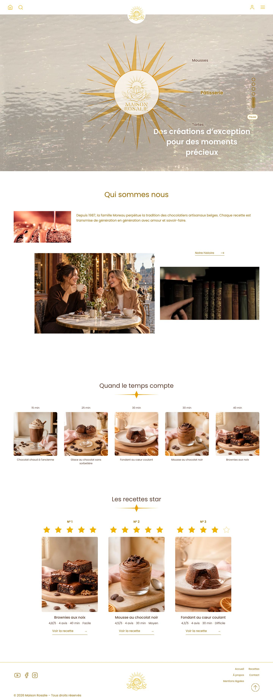
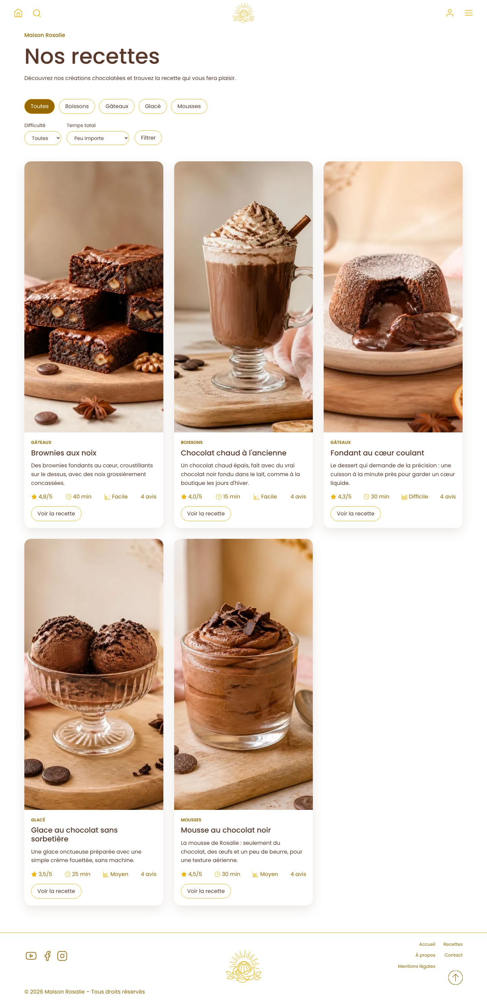
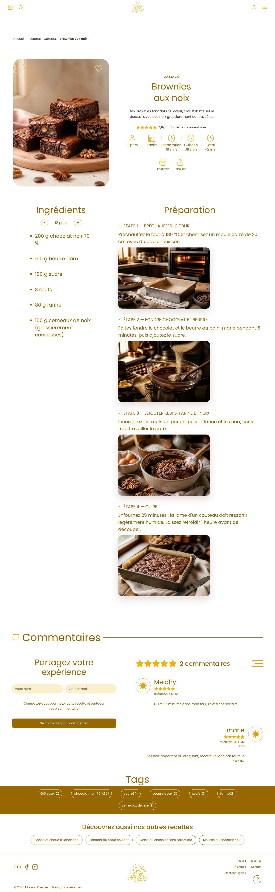
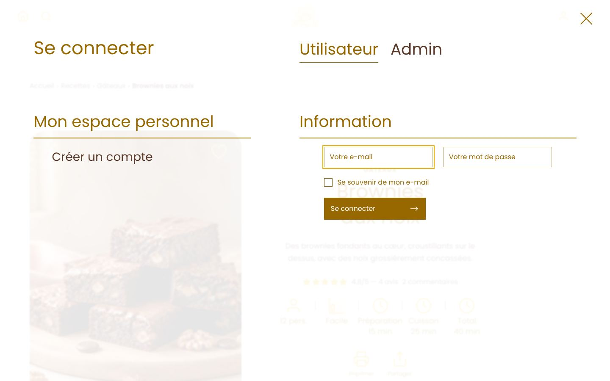
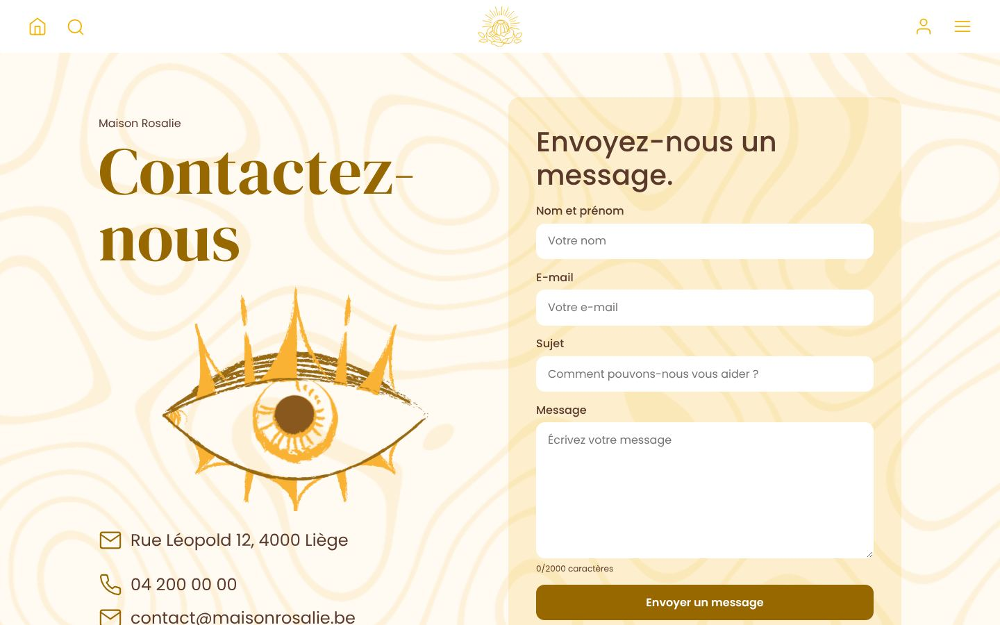
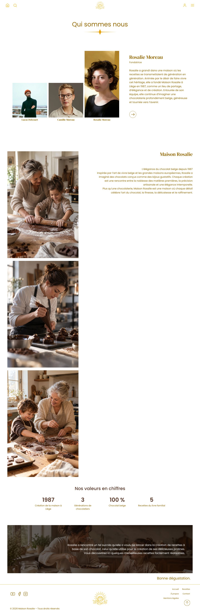
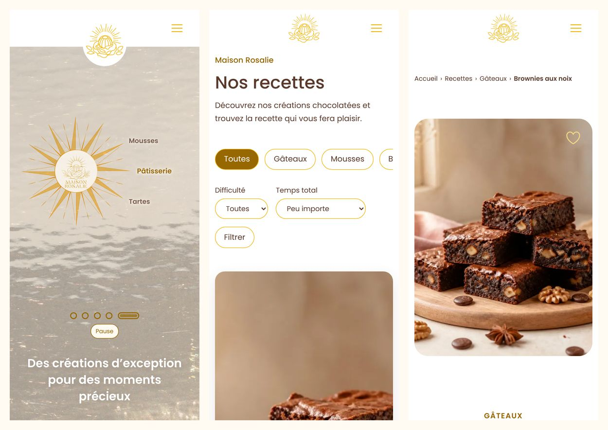

# La Maison Rosalie

Site web du livre de recettes au chocolat de **La Maison Rosalie**, chocolaterie belge fondée en 1987 par la famille Moreau. Chaque visiteur peut parcourir les recettes, les suivre pas à pas avec une photo par étape, les noter en étoiles et laisser un commentaire une fois connecté.

> Projet d'équipe réalisé au CF2M dans le cadre de la formation développeur web (4 semaines).

## Sommaire

1. [Équipe](#1-équipe)
2. [Fonctionnalités](#2-fonctionnalités)
3. [Choix techniques](#3-choix-techniques)
4. [Installation pas à pas](#4-installation-pas-à-pas)
5. [Comptes de test](#5-comptes-de-test)
6. [Les 5 recettes](#6-les-5-recettes)
7. [Identité visuelle](#7-identité-visuelle)
8. [Sécurité et règles de gestion](#8-sécurité-et-règles-de-gestion)
9. [Organisation du code](#9-organisation-du-code)
10. [Crédits et bibliothèques](#10-crédits-et-bibliothèques)
11. [Captures d'écran](#11-captures-décran)
12. [Documentation](#12-documentation)

## 1. Équipe

| Membre | Rôle principal | Référent |
|---|---|---|
| Lass (TNK-Sempai) | Base de données, modèle (classes Mapping et Manager), point d'entrée `index.php`, sécurité | Base de données et sécurité |
| Bruce (Bruce-Wuthrich) | Contrôleurs | |
| Bryan | Vues, CSS et JavaScript d'interface | |

Chaque développeur travaille sur sa propre branche. Toute fusion sur `main` passe par une Pull Request relue par un autre membre.

## 2. Fonctionnalités

- 4 pages : Accueil, Recettes (avec menu déroulant), À propos, Contact, plus une page Mentions légales.
- 5 recettes détaillées : ingrédients avec quantités, étapes numérotées avec photo, temps, difficulté et portions.
- Top 3 des recettes les mieux notées sur l'accueil, calculé par le backend.
- Inscription, connexion et déconnexion dans des fenêtres modales.
- Notation de 1 à 5 étoiles (une note par utilisateur et par recette, modifiable).
- Commentaires avec chargement par tranches de 10, suppression par l'auteur ou un administrateur.
- Formulaire de contact enregistré en base, avec protection anti-spam et accusé de réception par e-mail.
- Confirmation de l'adresse e-mail par lien à l'inscription (e-mails envoyés par SMTP avec PHPMailer).
- Recherche de recettes par titre, description, catégorie ou ingrédient, avec filtrage instantané des cartes pendant la frappe sur la page Recettes.
- Fiche recette : tags tirés de la base (catégorie et ingrédients) et liens vers les autres recettes en fin de page.
- Bonus : filtres de la page Recettes par catégorie, difficulté et temps total.
- Bonus : panneau d'administration en 3 onglets (modération des avis, messages de contact, ajout, modification et suppression de recettes avec photos).
- Bonus : recettes favorites par utilisateur (cœur sur la fiche, filtre « Mes favoris » sur la page Recettes).
- Espace « Mon compte » pour chaque membre : ses recettes favorites, les notes qu'il a données et ses avis (avec leur statut de modération). Lien dans le menu une fois connecté, et lien « Administration » réservé aux administrateurs.
- Bonus : feuille de style d'impression propre pour une fiche recette (voir ci-dessous).
- Bonus : changement du nombre de portions avec recalcul des quantités sur la fiche recette.
- Notifications temporaires après chaque action (succès ou erreur).
- Référencement : adresse canonique, aperçus de partage (Open Graph), données structurées schema.org (`Recipe` sur chaque fiche), plan du site XML généré depuis la base, `robots.txt` et `llms.txt` pour les assistants IA.

### Bonus du cahier des charges (section 12)

| Bonus | Niveau | Où le montrer pendant la démo |
|---|---|---|
| Recherche de recettes en temps réel par titre ou ingrédient | Facile | Page Recettes : taper « noix » ou « crème » dans la barre de recherche, les cartes se filtrent pendant la frappe |
| Feuille de style d'impression propre pour une page recette | Facile | Bouton « Imprimer » d'une fiche (voir ci-dessous) |
| Filtres par catégorie, difficulté et temps | Moyen | Page Recettes |
| Changement du nombre de portions avec recalcul des quantités | Moyen | Fiche recette : boutons − / + au-dessus des ingrédients (Brownies 12 → 6 personnes) |
| Recettes favorites par utilisateur | Moyen | Cœur d'une fiche (connecté), puis « Mes favoris » sur la page Recettes |
| Panneau d'administration : ajouter ou modifier une recette, modérer les commentaires | Difficile | Compte administrateur, `?pg=admin` |

### Imprimer une fiche recette (bonus)

Le bouton « Imprimer » de la fiche (ou Ctrl + P) produit une fiche propre sur **une seule page A4** :

- en haut, la photo, la catégorie, le titre, la description, la note et la fiche rapide (portions, difficulté, préparation, cuisson, total) ;
- en dessous, les ingrédients à gauche et les étapes à droite, chacune avec sa photo en vignette ; une étape n'est jamais coupée entre deux pages ;
- la navigation, le pied de page, les boutons, les commentaires, les tags et les autres recettes sont masqués ;
- les couleurs et la typographie restent celles de la fiche à l'écran.

Le style est entièrement dans `public/css/recipe.css` (bloc `@media print`), sans changer le HTML.

> **Astuce** : la date et l'adresse de la page en haut et en bas de la feuille sont ajoutées par le navigateur, pas par le site. Pour les enlever, décocher « En-têtes et pieds de page » dans les options de la fenêtre d'impression.

## 3. Choix techniques

| Couche | Technologie | Pourquoi |
|---|---|---|
| Structure | HTML5 sémantique | Imposé |
| Style | Bootstrap 5.3 + CSS personnalisé | Imposé. Bootstrap pour la grille responsive et la navigation repliable, notre CSS pour l'identité de la marque. |
| Interactions | JavaScript natif (ES6+) | Imposé, sans framework |
| Backend | **PHP 8 orienté objet**, sans framework | Voir ci-dessous |
| Base de données | **MariaDB** | Voir ci-dessous |
| Versioning | Git et GitHub | Imposé |

### Pourquoi PHP orienté objet

- Chaque table a sa classe **Mapping** (une ligne de la table, avec des setters qui valident chaque donnée) et sa classe **Manager** (toutes les requêtes SQL de la table). Les responsabilités sont claires et le code est facile à relire (QC-01).
- La validation est centralisée dans les setters : une donnée invalide lève une exception, quel que soit le contrôleur qui l'envoie.
- La connexion à la base est définie à un seul endroit, la classe `MyPDO` (singleton), et réutilisée partout (QC-03).
- C'est l'architecture vue en formation (modèle MVC avec contrôleurs procéduraux), que toute l'équipe maîtrise.

### Pourquoi MariaDB

- Gratuite et open source.
- Fonctionne très bien avec PHP via PDO, et elle est fournie avec WAMP.
- Utilise le langage SQL standard.
- Gère les contraintes d'intégrité dans la base elle-même (clés étrangères, `UNIQUE`, `CHECK`), comme le demande le cahier des charges.
- Permet de créer un compte applicatif aux droits limités.
- Très utilisée en Europe.

## 4. Installation pas à pas

### Prérequis

- **WAMP** (ou un équivalent) avec PHP 8.1 ou plus et **MariaDB** (le projet est configuré sur le port **3307**).
- Git.

### Étape 1 : récupérer le projet

```bash
git clone https://github.com/Bruce-Wuthrich/La-Maison-Rosalie.git
cd La-Maison-Rosalie
```

### Étape 2 : créer la base de données

Le script `data/maison_rosalie_structure.sql` crée la base vide puis la remplit avec les données de démonstration. Il peut être rejoué à volonté : il supprime et recrée tout (BE-60, BE-61).

**Avec phpMyAdmin** : se connecter en `root`, ne sélectionner aucune base, onglet **Importer**, choisir `data/maison_rosalie_structure.sql`, puis **Importer**.

**En ligne de commande (PowerShell)**, depuis la racine du projet (adapter le chemin à la version de MariaDB installée) :

```powershell
& "C:\wamp64\bin\mariadb\mariadb11.4.9\bin\mysql.exe" -h 127.0.0.1 -P 3307 -u root -p --default-character-set=utf8mb4 -e "source data/maison_rosalie_structure.sql"
```

Pour trouver le chemin de `mysql.exe` :

```powershell
Get-ChildItem C:\wamp64\bin\mariadb -Recurse -Filter mysql.exe | Select-Object FullName
```

### Étape 3 : créer le compte applicatif (droits limités)

Le site ne se connecte jamais avec `root` (SEC-09).

1. Copier `data/create-app-user.example.sql` en `data/create-app-user.sql` (ce fichier est ignoré par Git).
2. Dans la copie, remplacer `CHANGER_CE_MOT_DE_PASSE` par un mot de passe de votre choix.
3. Exécuter la copie en `root` (phpMyAdmin ou la même commande que l'étape 2, avec `source data/create-app-user.sql`).

Le compte `rosalie_app` reçoit uniquement les droits `SELECT`, `INSERT`, `UPDATE` et `DELETE` sur la base `maison_rosalie`.

### Étape 4 : configurer le site

1. Copier `config-dev-exemple.php` en `config-dev.php` (ce fichier est ignoré par Git et ne doit jamais être commité, SEC-08).
2. Dans `config-dev.php`, mettre le mot de passe choisi à l'étape 3 dans `DB_PWD`. Vérifier `DB_PORT` (3307) et `RACINE_URL`.
3. Laisser `DISPLAY_ERRORS` à `false` : les erreurs sont écrites dans le journal PHP, jamais affichées au visiteur (SEC-10).
4. `RACINE_URL` doit être l'adresse du site (par exemple `http://maison-rosalie/`) : elle sert à construire le lien de confirmation envoyé par e-mail.
5. **E-mails (facultatif)** : renseigner les constantes `MAIL_*` (hôte SMTP, port, chiffrement, identifiant, mot de passe, adresse d'expédition). **Sans ces réglages, le site fonctionne normalement** : aucun e-mail n'est envoyé et les nouveaux comptes sont confirmés immédiatement.

### Étape 5 : configurer l'hôte virtuel

Créer un VirtualHost `maison-rosalie` dans WAMP, avec comme dossier racine le dossier **`public/`** du projet. Seul ce dossier est accessible depuis le navigateur : la configuration, le modèle et les scripts SQL restent hors d'atteinte (SEC-08).

Ouvrir ensuite http://maison-rosalie/

### Mise en ligne (hébergement mutualisé)

Le site a été mis en ligne sur l'hébergement fourni par le CF2M (Nuxit) :

1. Le domaine pointe sur le dossier `public/` : seul ce dossier est servi par le navigateur.
2. Envoi par FTP de `controller/`, `lib/`, `model/`, `view/`, `public/` et d'un fichier `config-prod.php` à la racine, au-dessus de `public/`. Ce fichier se crée en copiant le modèle `config-prod-exemple.php` puis en le remplissant avec les accès de l'hébergeur ; il n'est jamais commité. `index.php` le charge automatiquement s'il existe, à la place de `config-dev.php`. `RACINE_URL` y contient l'adresse publique en HTTPS.
3. Fichiers `.htaccess` « Require all denied » dans `controller/`, `model/`, `view/` et `lib/`, et protection des fichiers `config-*` à la racine, en sécurité supplémentaire.
4. Import de la base dans phpMyAdmin avec `data/maison_rosalie_hebergement.sql` : même contenu que le script d'installation, sans `DROP/CREATE DATABASE` ni `USE`, car sur un hébergement mutualisé la base est créée par l'hébergeur.
5. Dossier `public/uploads/recettes/` accessible en écriture pour les photos de l'admin.

## 5. Comptes de test

| Rôle | Email | Mot de passe |
|---|---|---|
| Administrateur | `admin@maisonrosalie.be` | `Rosalie-Admin-2026` |
| Membre | `marie@example.com` | `Rosalie-Membre-2026` |
| Membre | `bruce@example.com` | `Rosalie-Membre-2026` |
| Membre | `bryan@example.com` | `Rosalie-Membre-2026` |
| Membre | `meidhy@example.com` | `Rosalie-Membre-2026` |

Les mots de passe sont stockés hachés avec `password_hash` (bcrypt). Ils ne sont lisibles nulle part dans la base.

Pour tester la notation, utiliser un compte **membre** : l'administrateur est l'auteur des recettes de démonstration, et on ne peut pas noter sa propre recette.

Données de démonstration : 5 recettes, 4 catégories, 12 ingrédients, 20 étapes, 20 notes et 8 commentaires.

## 6. Les 5 recettes

| 1 | Chocolat chaud à l'ancienne | Boissons | Facile | 5 min | 10 min | 2 | Benny |
| 2 | Mousse au chocolat noir | Mousses | Moyen | 25 min | 5 min | 6 | Bryan |
| 3 | Brownies aux noix | Gâteaux | Facile | 15 min | 25 min | 12 | Bruce |
| 4 | Fondant au cœur coulant | Gâteaux | Difficile | 20 min | 10 min | 4 | Meidhy |
| 5 | Glace au chocolat sans sorbetière | Glacé | Moyen | 20 min | 5 min | 6 | Slava |

4 catégories utilisées, au moins une recette de chaque difficulté, et 4 étapes illustrées par recette.

## 7. Identité visuelle

### Palette

| Variable CSS | Couleur | Usage |
|---|---|---|
| `--color-gold` | `#f1b300` | Accents, étoiles, survols |
| `--color-gold-text` | `#976700` | Titres et liens dorés lisibles sur fond clair |
| `--color-brown` | `#5a392b` | Texte principal |
| `--color-cream` | `#fffaf2` | Fond de page |
| `--color-white` | `#ffffff` | Cartes et navigation |

### Typographies

- **Poppins** (Google Fonts) : texte courant, boutons, navigation (`--font-body`).
- **DM Serif Display** (fichier local, licence OFL) : titres éditoriaux (`--font-display`).

### Composants

L'interface de La Maison Rosalie a été développée en HTML5, CSS3 et JavaScript natif, avec l'utilisation de Bootstrap 5.3 pour certains composants et la mise en page responsive.

L'objectif était de créer une expérience utilisateur moderne, fluide et accessible, tout en respectant l'identité visuelle de la maquette reçue de la designeuse (Vladyslava Yastrebova).

#### Navigation et menu responsive

La barre de navigation permet d'accéder aux différentes pages du site, de rechercher une recette et de se connecter à son compte.

Sur ordinateur, les différentes actions sont directement accessibles depuis la navbar. Sur mobile, la recherche et la connexion sont intégrées au menu burger afin de libérer de l'espace.

Le menu utilise le composant Collapse de Bootstrap, complété par du JavaScript pour gérer le déplacement des éléments en fonction de la largeur de l'écran.

#### Hero et animations de l'accueil

La page d'accueil possède un élément central en forme de soleil, servant de navigation interactive entre les catégories de recettes.

Ce composant propose une rotation automatique, une navigation manuelle, des indicateurs de pagination et un panneau présentant la catégorie sélectionnée.

Les catégories sont récupérées depuis la base de données par PHP, puis transmises au JavaScript. Le hero s'adapte ainsi aux catégories disponibles sans devoir modifier manuellement leurs noms dans le code.

#### Cartes de recettes

Les recettes sont présentées sous forme de cartes contenant une photographie, le nom, la catégorie, une description et plusieurs informations pratiques.

Une animation de zoom sur l'image accompagne le survol de la carte.

La disposition s'adapte à la taille de l'écran : trois colonnes sur grand écran, deux sur tablette et une sur mobile.

#### Boutons et interactions

Les boutons et les liens interactifs utilisent les couleurs principales de la charte graphique.

Des changements de couleur, des transitions et des effets au survol permettent d'identifier les éléments interactifs.

Les filtres de recettes possèdent également un état actif pour indiquer à l'utilisateur la sélection en cours.

Sur les fiches recettes, le bouton Favoris prend la forme d'un cœur transparent avec un contour doré. Lorsqu'une recette est ajoutée aux favoris, le cœur se remplit.

#### Formulaires et fenêtres modales

Les formulaires utilisent des champs et des boutons cohérents avec l'identité visuelle du site.

Les fenêtres de connexion et d'inscription sont accessibles depuis la navigation. Une transition animée permet de passer d'un formulaire à l'autre.

La disposition des champs s'adapte à la taille de l'écran afin de faciliter leur utilisation sur mobile.

#### Notifications

Le site utilise des notifications temporaires pour informer l'utilisateur du résultat de certaines actions.

Les messages de réussite et d'erreur possèdent des styles distincts. Les notifications peuvent être fermées manuellement et certains messages disparaissent automatiquement après quelques secondes.

#### Responsive design et accessibilité

L'interface a été adaptée aux ordinateurs, tablettes et smartphones grâce aux Media Queries CSS, aux grilles responsives et à certaines fonctionnalités de Bootstrap.

Une attention particulière a été portée à la lisibilité, aux contrastes, aux états de focus et aux libellés accessibles des boutons.

Les animations tiennent également compte de la préférence système `prefers-reduced-motion` afin de limiter les mouvements lorsque l'utilisateur le souhaite.

L'ensemble des composants vise à conserver une expérience cohérente sur les différentes pages du site.

Le logo a été créé par l'équipe (format SVG) et est utilisé dans la navigation, le hero et le pied de page.

## 8. Sécurité et règles de gestion

### Politique de mot de passe (BE-01)

10 caractères minimum, avec au moins une majuscule, une minuscule et un chiffre.

### Limites anti-abus

| Action | Limite | Exigence |
|---|---|---|
| Connexion | 5 échecs en 15 minutes (par email ou par IP), puis blocage 15 minutes | BE-03 |
| Commentaire | 5 commentaires maximum par utilisateur sur 10 minutes | BE-44 |
| Contact | 3 messages maximum par adresse IP sur une heure | BE-50 |

### Mesures en place

- Requêtes SQL préparées partout (SEC-01).
- Échappement de toute donnée affichée avec `htmlspecialchars` (SEC-02).
- Jeton CSRF sur toutes les actions qui modifient des données, déconnexion comprise (SEC-03).
- Mots de passe hachés avec `password_hash` et vérifiés avec `password_verify` (SEC-04).
- Sessions : identifiant renouvelé à la connexion, cookie `httponly` et `samesite=Lax`, mode strict, expiration après 30 minutes d'inactivité, déconnexion qui détruit la session (SEC-05).
- Contrôle d'accès côté serveur sur chaque action, droits relus en base (SEC-06).
- Validation serveur de chaque donnée dans les classes Mapping (SEC-07).
- Secrets hors du dépôt (`config-dev.php` et `create-app-user.sql` ignorés) et hors du dossier public (SEC-08).
- Compte de base de données aux droits limités (SEC-09).
- Aucune erreur technique visible, détails dans le journal serveur (SEC-10).
- Historique Git vérifié : aucun secret, même supprimé depuis (SEC-11).

## 9. Organisation du code

```
La-Maison-Rosalie/
├── config-dev-exemple.php      modèle de configuration locale, sans secret
├── config-prod-exemple.php     modèle de configuration pour la mise en ligne, sans secret
├── controller/                 contrôleurs (un par fonctionnalité) + ControllerHelpers.php
├── data/
│   ├── maison_rosalie_structure.sql    script d'import unique (structure + démo)
│   └── create-app-user.example.sql     modèle du compte applicatif
├── docs/                       documentation API, plan de tests, rapport technique
├── lib/PHPMailer/              bibliothèque d'envoi d'e-mails (hors de public/)
├── model/
│   ├── MyPDO.php               connexion unique à la base (singleton)
│   ├── abstract/               AbstractMapping (hydratation par les setters)
│   ├── interface/              ManagerInterface, UserInterface
│   ├── mapping/                une classe par table (validation des données)
│   └── manager/                une classe par table (requêtes SQL)
├── public/                     seul dossier accessible depuis le navigateur
│   ├── index.php               point d'entrée et routeur
│   ├── assets/img/             images (un dossier par recette)
│   ├── uploads/                photos envoyées depuis l'admin (ignoré par Git)
│   ├── css/                    base.css + une feuille par page (home, recipes, recipe, about, contact, legal, admin, error)
│   └── js/                     scripts.js, ajax.js, auth.js, contact.js, flash.js, recettes.js, recherche.js, favoris.js, portions.js, admin.js, admin-recette.js
└── view/
    ├── inc/                    header, navbar, footer, modale de connexion, notifications
    ├── publicView/             pages publiques
    └── privateView/            pages réservées (administration)
```

Les vues ne contiennent aucun accès aux données : les contrôleurs préparent les variables, les vues les affichent (QC-02).

## 10. Crédits et bibliothèques

| Élément | Source | Justification |
|---|---|---|
| Bootstrap 5.3.8 (CDN jsDelivr) | getbootstrap.com | Imposé par le cahier des charges |
| Police Poppins | Google Fonts | Lisibilité, style moderne et chaleureux |
| Police DM Serif Display | Google Fonts, fichier local (licence SIL OFL, `public/assets/fonts/dm-serif-display/OFL.txt`) | Titres élégants dans l'esprit d'une maison artisanale |
| Icônes | Feather Icons (licence MIT, `public/assets/img/LICENSE-feather.txt`) | Icônes au trait cohérentes sur tout le site |
| PHPMailer 6.9.3 | github.com/PHPMailer/PHPMailer (licence LGPL 2.1, `lib/PHPMailer/LICENSE`), 3 fichiers copiés sans Composer | Envoi d'e-mails par SMTP authentifié et chiffré, que la fonction `mail()` de PHP ne gère pas |
| Photos principales des recettes | Générées avec Canva, droits d'utilisation couverts par la licence Canva payée par Tanuki Corporation | Photo d'en-tête de chaque fiche |
| Photos des étapes | Générées par intelligence artificielle (Canva) à partir de descriptions écrites par l'équipe. Aucun style d'artiste, marque, logo ni personne réelle n'a été demandé. | Illustrer chaque étape (FE-33) |
| Photos des pages Accueil et À propos | Générées avec ChatGPT à partir de prompts originaux écrits par l'équipe | Illustrer l'histoire de la maison (FE-13, FE-40) |

## 11. Captures d'écran

### Accueil


### Recettes


### Fiche recette


### Connexion


### Contact


### À propos


### Version mobile


## 12. Documentation

- [Documentation des points d'accès (API)](docs/API.md)
- [Plan de tests](docs/plan-de-tests.md)
- [Rapport technique](docs/rapport-technique.md)